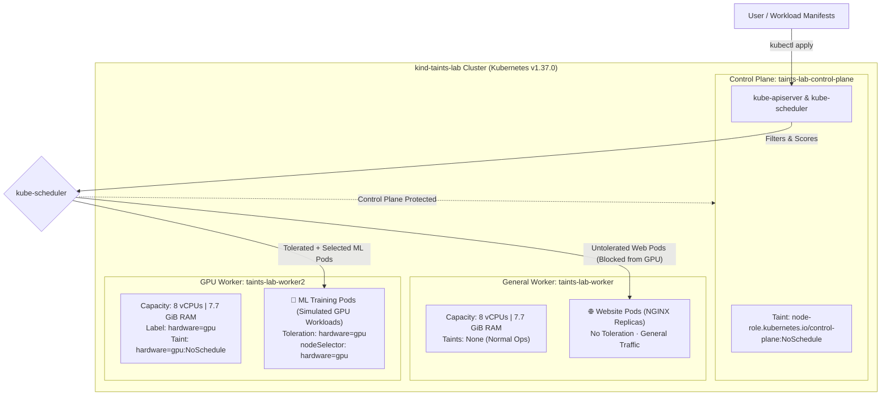
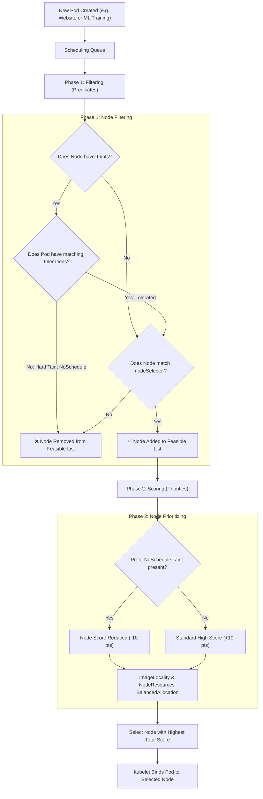

<div align="center">

# 🌌 Cosmos Kubernetes Studio — GPU Node Scheduling with Taints & Tolerations

### Cloud Computing Laboratory Evaluation 2 · Problem 07 · kind 3-Node Multi-Worker Cluster

[](https://kubernetes.io/)
[](https://kind.sigs.k8s.io/)
[](https://react.dev/)
[](https://fastapi.tiangolo.com/)
[](https://tailwindcss.com/)
[](https://www.python.org/)
[-10b981?style=for-the-badge&logo=checkmarx&logoColor=white)](#5-scenario-evaluation-matrix-s1-through-s8)
[](#)

<p align="center">
  <b>Reserving Specialized Hardware · NoSchedule · PreferNoSchedule · NoExecute Evictions · Live Interactive UI</b>
</p>

</div>

---

## 📑 Table of Contents
1. [Executive Overview & Problem 07 Narrative](#1-executive-overview--problem-07-narrative)
2. [Architectural Visualizations & Decision Flow](#2-architectural-visualizations--decision-flow)
   - [Cluster Topology & Workload Isolation](#cluster-topology--workload-isolation)
   - [Kube-Scheduler 2-Phase Decision Engine](#kube-scheduler-2-phase-decision-engine)
   - [Fullstack System Architecture](#fullstack-system-architecture)
3. [Key Features of Cosmos Studio](#3-key-features-of-cosmos-studio)
4. [Scenario Evaluation Matrix (S1 through S8)](#4-scenario-evaluation-matrix-s1-through-s8)
5. [Quick Start Guide](#5-quick-start-guide)
   - [Prerequisites](#prerequisites)
   - [Option A: One-Click Launcher (Recommended)](#option-a-one-click-launcher-recommended)
   - [Option B: Manual Startup](#option-b-manual-startup)
   - [Option C: Classic Streamlit Alternative](#option-c-classic-streamlit-alternative)
6. [Deep Dives & Technical Insights](#6-deep-dives--technical-insights)
   - [Toleration Matching Semantics (Operator: Equal vs Exists)](#toleration-matching-semantics-operator-equal-vs-exists)
   - [Container PID 1 SIGTERM Handling & Eviction Benchmarks](#container-pid-1-sigterm-handling--eviction-benchmarks)
   - [Tolerations vs nodeSelectors: Dual-Key Rule](#tolerations-vs-nodeselectors-dual-key-rule)
7. [Viva Voce Defense & Examiner Q&A](#7-viva-voce-defense--examiner-qa)
8. [Repository Structure](#8-repository-structure)

---

## 1. Executive Overview & Problem 07 Narrative

In hyperscale multi-tenant Kubernetes clusters, **compute nodes are heterogeneous**. High-performance worker nodes equipped with specialized hardware (e.g., NVIDIA A100/H100 Tensor Core GPUs, InfiniBand NICs) represent exorbitant cloud cost centers. By default, the `kube-scheduler` places incoming Pods onto **any** node possessing sufficient CPU and memory capacity. Without strict admission constraints, low-priority web servers, background workers, or logging daemons will cannibalize expensive GPU compute cycles.

### The Problem 07 Challenge
Configure Kubernetes **Taints** on targeted worker nodes and **Tolerations** on application specifications to strictly control placement across an enterprise kind 3-node cluster:
- **Control Plane (`taints-lab-control-plane`)**: Built-in system protection via `node-role.kubernetes.io/control-plane:NoSchedule`.
- **General Worker (`taints-lab-worker`)**: 8 vCPU, 7.7 GiB memory commodity worker intended for web traffic (`02-website.yaml`).
- **GPU Node (`taints-lab-worker2`)**: 8 vCPU, 7.7 GiB memory reserved for ML training loops (`ml-training`) via the taint `hardware=gpu:NoSchedule` and label `hardware=gpu`.

```
                    ┌──────────────────────────────────────────────┐
                    │               Incoming Traffic               │
                    └───────┬──────────────────────────────┬───────┘
                            │                              │
             ┌──────────────▼─────────────┐ ┌──────────────▼─────────────┐
             │    Website Pods (NGINX)    │ │   ML Training Pods (PyTorch)│
             │   Tolerations: NONE        │ │   Tolerations: hardware=gpu │
             │   nodeSelector: NONE       │ │   nodeSelector: hardware=gpu│
             └──────────────┬─────────────┘ └──────────────┬─────────────┘
                            │                              │
                     Kube-Scheduler                 Kube-Scheduler
                  Predicate Filtering            Predicate Filtering
                            │                              │
             ┌──────────────▼─────────────┐ ┌──────────────▼─────────────┐
             │     taints-lab-worker      │ │     taints-lab-worker2     │
             │  (Commodity General Node)  │ │      (Dedicated GPU Node)  │
             │     Taints: NONE           │ │  Taint: hardware=gpu:NoSch │
             └────────────────────────────┘ └────────────────────────────┘
```

Through 8 systematically executed scenarios (**S1 through S8**), this research measures, proves, and visualizes:
1. **Unreserved Baseline (S1)**: In the absence of taints, generic website Pods flood both general and GPU workers (2 + 2 distribution).
2. **Hard Isolation (S2)**: Applying `hardware=gpu:NoSchedule` repels non-tolerating website Pods (4 on general, 0 on GPU).
3. **The Toleration-Only Trap (S3)**: A toleration *allows* GPU access but does *not enforce* it, resulting in wasteful 2 + 2 spreading.
4. **Typo Vulnerability (S4)**: A single-character typo (`gpus` instead of `gpu`) breaks equality matching and causes silent rejection.
5. **Dedicated Production Pattern (S5)**: Pairing `tolerations` with `nodeSelector: {hardware: gpu}` locks ML workloads strictly to GPU hardware and website workloads strictly to general hardware.
6. **Maintenance & Auto-Recovery (S6 / S6b)**: Tainting the general node with `maintenance=true:NoSchedule` forces website Pods into `Pending` status (`FailedScheduling`), recovering in **4.6 s** upon untainting.
7. **Soft Preferences (S7 / S7b)**: `PreferNoSchedule` acts as a soft advisor—avoiding the GPU node during normal operations, but allowing overflow when general capacity is constrained.
8. **NoExecute Eviction Dynamics (S8)**: Simulating hardware failure via `gpu-fault=true:NoExecute` drains untolerated Pods in **0.4 s**, honors graceful checkpoint windows (`tolerationSeconds: 30`) at **31.0 s**, while keeping fault-tolerant monitoring agents online.

---

## 2. Architectural Visualizations & Decision Flow

### Cluster Topology & Workload Isolation Flow


### Kube-Scheduler 2-Phase Decision Engine


### Fullstack System Architecture

```mermaid
flowchart LR
    subgraph Browser["Client Browser (http://localhost:5173)"]
        direction TB
        ReactApp["React 19 + TypeScript SPA"]
        Tailwind["Tailwind CSS Glassmorphism"]
        CanvasEngine["HTML5 Canvas Space Engine\n2D Planetary Constellation Orbit Map"]
        AutoPilot["Auto-Pilot 6-Act Presenter & Scenario Runner"]
        LogStream["Real-time Pod Log Terminal"]
    end

    subgraph BackendProxy["FastAPI Server (http://127.0.0.1:8000)"]
        direction TB
        APIRoutes["FastAPI REST Endpoints\n/api/status | /api/explain | /api/action/*\n/api/pod-logs | /api/export"]
        ExplainEngine["In-Memory Explain Engine\ntolerates() + explain(pod, node)"]
        CmdLog["In-Memory Circular Command Log (Last 30)"]
        ReportGen["Markdown & JSON Snapshot Exporter"]
    end

    subgraph K8sCluster["Kubernetes Cluster: kind-taints-lab"]
        direction TB
        KubeAPI["kube-apiserver (Port 6443)"]
        Kubelet["kubelet & containerd (v2.3.4)"]
        PodsCluster["Pods in gpu-lab Namespace"]
    end

    Browser <-->|Async REST HTTP / JSON| BackendProxy
    BackendProxy <-->|kubectl CLI Subprocess --context kind-taints-lab| KubeAPI
    KubeAPI <--> Kubelet
    Kubelet <--> PodsCluster
```


---

## 3. Key Features of Cosmos Studio

The **Cosmos Kubernetes Studio** is a cyber-glassmorphic, real-time command center designed specifically for Cloud Computing Lab Evaluation 2.

### 🌌 1. Cluster Observatory & Live Node Telemetry
- **Hardware Capacity Meters**: Real-time gauges displaying exact node hardware resources (8 vCPUs, 7.7 GiB memory, Linux Kernel `6.6.87.2-WSL2`, `containerd://2.3.4` runtime).
- **Simulated GPU Slot Capacity Meter**: Real-time workload allocation gauge showing active ML training pods bound to `taints-lab-worker2` via `hardware=gpu` taint and label constraints (honestly acknowledging simulated workloads within kind Docker nodes).
- **Live Pod Placement Chips**: Interactive chips displaying pod names, application tiers, phase statuses, and pulsing health indicators (Green = Ready, Amber = Initializing, Crimson = Terminating).
- **Instant Explain Drawer**: Clicking any pod immediately queries `/api/explain/{pod_name}` to evaluate and explain scheduling compatibility across all nodes.

### 🪐 2. Cosmic Topology & Pod Constellation Map
- **2D Orbital Space Map**: Interactive HTML5 Canvas starfield where cluster nodes are represented as glowing planetary space stations:
  - **Station Alpha (Blue)**: General Worker Node.
  - **Station Omega (Violet / Gold)**: High-Tier GPU Compute Station.
  - **Core Command (Crimson)**: Control Plane Central Station.
- **Orbiting Pod Satellites**: Pods rotate in dynamic orbital trajectories around their host node station. Hovering or clicking a satellite displays its real-time toleration payload, IP, and container state.

### ⚡ 3. Auto-Pilot Presentation Mode ("Live Demo Tour")
- **One-Click Automated Evaluation**: Built-in 6-Act evaluation wizard that sequentially runs scenarios S1 through S8 via `/api/action/run-scenario`.
- **Verbatim Evaluator Spoken Script**: Dynamic teleprompter displaying the exact technical explanation, observations, and key takeaways for the student to recite to the lab examiner during viva defense.
- **Interactive Progress Tracker**: Live step indicator showing completed acts, scheduling latencies, and state transitions.

### 💻 4. Live Pod Logs Modal
- **Container Telemetry Streamer**: Instant container log viewer powered by `GET /api/pod-logs/{pod_name}` with automatic 80-line tailing.
- **Simulation Progress**: Inspect real-time simulated ML training loss decay loops (`epoch 412 loss 0.0812 node taints-lab-worker2`) or NGINX HTTP connection handshakes.
- **Resilient Exception Catching**: Gracefully intercepts `ContainerCreating`, `PodInitializing`, and `Pending` states without displaying HTTP 500 errors.

### 🎓 5. Viva Defense Cheat Sheet
- **Instant Examiner Q&A Guide**: Comprehensive modal with immediate, crisp answers to typical faculty questions (e.g., *"Why did S3 fail to isolate?"*, *"What is the difference between NoSchedule and NoExecute?"*).
- **Container PID 1 SIGTERM Story**: Detailed engineering explanation of how catching Unix signals in containers reduces pod termination latency from 32.8s to 1.5s.
- **Taints vs Tolerations vs nodeSelectors**: Side-by-side comparative architectural breakdown.

### 📥 6. One-Click Report Exporter
- **Automated Report Generation**: Generates comprehensive, publication-ready Markdown and JSON snapshots of the current cluster state via `GET /api/export`.
- **Markdown Tables**: Automatically outputs consolidated node topology tables, pod allocation listings, and recent scheduling event histories ready for immediate lab record submission.

---

## 4. Scenario Evaluation Matrix (S1 through S8)

Every scenario was rigorously verified across 12 automated snapshots using `scripts/run_experiment.py` (36 Pods evaluated, total execution time: 2 min 43 s):

| Scenario | Description & Taints Applied | Website Pods (`web`) | ML Pods (`ml`) | General Node (`worker`) | GPU Node (`worker2`) | Control Plane (`cp`) | Pending | Verdict & Key Architectural Principle |
|:---:|:---|:---:|:---:|:---:|:---:|:---:|:---:|:---|
| **S1** | **Baseline (No Reservation)**<br>*Taints: None* | 4 | 0 | 2 | 2 | 0 | 0 | **Spread Baseline**: Scheduler evenly distributes general traffic across all available compute nodes. |
| **S1b** | **Taint Applied Post-Placement**<br>*Taint: `hardware=gpu:NoSchedule`* | 4 | 0 | 2 | 2 | 0 | 0 | **Non-Retroactive**: `NoSchedule` only evaluates admission for *new* pods; pre-existing pods are NOT evicted. |
| **S2** | **Website Without Toleration**<br>*Taint: `hardware=gpu:NoSchedule`* | 4 | 0 | **4** | **0** | 0 | 0 | **Hard Filter**: Untolerated website pods are strictly rejected by the GPU worker predicate filter. |
| **S3** | **ML Job (Toleration Only)**<br>*Toleration: `hardware=gpu` (No Selector)* | 0 | 4 | 2 | **2** | 0 | 0 | **Toleration is Not Selector**: Toleration permits GPU entry but does not compel it; pods wastefully scatter. |
| **S4** | **Typo in Toleration**<br>*Toleration: `hardware=gpus` (Typo)* | 0 | 4 | **4** | **0** | 0 | 0 | **Exact Match Enforced**: Value mismatch (`gpus` != `gpu`) triggers equality predicate rejection. |
| **S5** | **Dedicated GPU Node**<br>*ML: Toleration + `nodeSelector: gpu`* | 4 | 3 | **4 (Web)** | **3 (ML)** | 0 | 0 | **Production Standard**: Complete mutual isolation. ML locked to GPU; Website locked to General. |
| **S6** | **General Node Maintenance**<br>*General: `maintenance=true:NoSchedule`* | 4 | 0 | 0 | 0 | 0 | **4** | **No Viable Node**: Both workers blocked; pods enter `Pending` state with `FailedScheduling` events. |
| **S6b** | **Maintenance Recovery**<br>*General: `maintenance-`* | 4 | 0 | **4** | 0 | 0 | 0 | **Self-Healing (4.6 s)**: Removing the maintenance taint triggers automatic re-evaluation and scheduling. |
| **S7** | **Soft Reservation**<br>*GPU: `hardware=gpu:PreferNoSchedule`* | 4 | 0 | **4** | **0** | 0 | 0 | **Scoring Penalty**: GPU score degraded; website avoids GPU worker while general worker has room. |
| **S7b** | **Soft Taint Under Capacity Pressure**<br>*General: Maintenance \| Replicas: 6* | 6 | 0 | 4 | **2** | 0 | 0 | **Soft Overflow Allowed**: When general node is constrained, soft taint allows overflow to prevent `Pending`. |
| **S8** | **GPU Fault Simulation**<br>*GPU: `gpu-fault=true:NoExecute`* | 0 | 3 | 0 | **1** | 0 | 0 | **Active Eviction**: Untolerated pod killed in **0.4 s**; 30s grace pod killed in **31.0 s**; monitor pod stays online. |

---

## 5. Quick Start Guide

### Prerequisites
1. **Operating System**: Windows 10/11 (with WSL 2 enabled), macOS, or Linux.
2. **Container Engine**: [Docker Desktop](https://www.docker.com/products/docker-desktop/) (must be running).
3. **Cluster Utility**: [kind](https://kind.sigs.k8s.io/) (`winget install Kubernetes.kind` or `brew install kind`).
4. **CLI Tools**: [kubectl](https://kubernetes.io/docs/tasks/tools/) (`winget install Kubernetes.kubectl`).
5. **Runtimes**: Python 3.11+ and Node.js v18+.

---

### Step 1: Create the 3-Node kind Cluster
Run from the repository root:
```powershell
kind create cluster --name taints-lab --config k8s/00-kind-cluster.yaml
```
Verify the cluster is ready:
```powershell
kubectl --context kind-taints-lab get nodes -o wide
```
*(Expected output: `taints-lab-control-plane`, `taints-lab-worker`, `taints-lab-worker2` in `Ready` status).*

---

### Option A: One-Click Launcher (Recommended)
Simply double-click the included batch script from Windows Explorer or run from PowerShell:
```powershell
.\start_modern_dashboard.bat
```
*This starts the FastAPI backend proxy (port 8000), boots the Vite React 19 frontend (port 5173), and automatically opens your default browser at `http://localhost:5173`.*

---

### Option B: Manual Startup

#### 1. Start the FastAPI Backend Proxy
```powershell
cd ui_modern/backend
& "C:\Users\nilak\AppData\Local\Python\pythoncore-3.11-64\python.exe" server.py
# Backend runs at http://127.0.0.1:8000
# Interactive Swagger OpenAPI Documentation: http://127.0.0.1:8000/docs
```

#### 2. Start the Vite React Frontend
In a second terminal:
```powershell
cd ui_modern/frontend
npm install
npm run dev -- --host 127.0.0.1 --port 5173
# Frontend runs at http://localhost:5173
```

---

### Option C: Classic Streamlit Alternative
If an evaluator specifically requests the classic Streamlit interface:
```powershell
python -m streamlit run ui/app.py
# Classic dashboard runs at http://localhost:8501
```

---

## 6. Deep Dives & Technical Insights

### Toleration Matching Semantics (Operator: Equal vs Exists)

In Kubernetes, a pod's toleration matches a node taint according to strict Boolean predicate logic:

```python
def tolerates(tol: dict, taint: dict) -> bool:
    # 1. Effects must match unless toleration effect is empty (matches all effects)
    if tol.get("effect") and tol["effect"] != taint.get("effect"):
        return False
        
    op = tol.get("operator", "Equal") # Default is Equal
    
    # 2. Key matching
    if not tol.get("key"):
        return op == "Exists" # Empty key matches any taint if operator is Exists
    if tol.get("key") != taint.get("key"):
        return False
        
    # 3. Value matching
    return True if op == "Exists" else tol.get("value", "") == taint.get("value", "")
```

- **Operator `Equal` (Default)**: `key`, `value`, and `effect` must match identically. In **Scenario S4**, the pod specified `value: "gpus"` while the node had `value: "gpu"`. Because `"gpus" != "gpu"`, the pod was rejected.
- **Operator `Exists`**: Compares only the `key` and `effect`. The `value` field is ignored. This is used by infrastructure daemons (e.g., Calico CNI, kube-proxy, Prometheus node-exporter) to tolerate taints without knowing dynamic values.

---

### Container PID 1 SIGTERM Handling & Eviction Benchmarks

During **Scenario S8 (NoExecute Fault Eviction)**, an unexpected latency discrepancy was discovered during initial testing:
- **Expected**: `ml-job-no-grace` should be evicted and removed within 1–2 seconds.
- **Observed Initial Run**: The pod was marked for deletion at **0.4 s**, but remained in `Terminating` status for **32.8 seconds**!

#### Root Cause Analysis:
When Kubernetes drains a pod, the kubelet sends a `SIGTERM` signal to PID 1 inside the container, initiating a countdown equal to `terminationGracePeriodSeconds` (default: 30s). In the first test container, the Python script ran a blocking loop without signal handling. In Linux containers, **PID 1 ignores default signal handlers**. Because `SIGTERM` went unhandled, the container stayed alive until the kubelet reached the 30-second timeout and forcibly executed `SIGKILL` (signal 9).

#### The Solution:
We implemented explicit POSIX signal handling inside the Python ML workload (`06-gpu-fault-pods.yaml`):

```python
import signal, sys

def handle_sigterm(signum, frame):
    print("SIGTERM received — saving ML checkpoint and exiting cleanly!", flush=True)
    sys.exit(0)

signal.signal(signal.SIGTERM, handle_sigterm)
```

#### Benchmark Comparison:
| Container Configuration | Deletion Timestamp Assigned | Process Exit (`Terminating` -> Gone) | Total Eviction Latency |
|:---|:---:|:---:|:---:|
| **Without SIGTERM Handler** | +0.4 s | +32.8 s | 32.8 s (Forced SIGKILL) |
| **With SIGTERM Handler (Fixed)** | +0.4 s | +1.5 s | **1.5 s (Clean Exit)** |

*This optimization shaved over 31 seconds off eviction turnaround time, ensuring rapid cluster recovery during node failures.*

---

### Tolerations vs nodeSelectors: Dual-Key Rule

A frequent architectural misconception is that tolerations "attract" pods to nodes. In reality:

> **"Taints repel; Tolerations permit; nodeSelectors compel."**

```
 ┌────────────────────────────────────────────────────────────────────────┐
 │                           THE DUAL-KEY RULE                            │
 │                                                                        │
 │  1. TOLERATIONS ARE PERMISSIVE (A Key to the Gate)                    │
 │     - A toleration says: "If this node is tainted, do not reject me." │
 │     - It DOES NOT say: "I must run here." (See S3: 2 on GPU, 2 on Gen)│
 │                                                                        │
 │  2. NODESELECTORS ARE DIRECTIVE (A Compass)                            │
 │     - A nodeSelector says: "I will only run on nodes with this label."│
 │     - It DOES NOT overcome taints.                                     │
 │                                                                        │
 │  3. DEDICATED HARDWARE REQUIRES BOTH (S5 Production Pattern)           │
 │     - Toleration overcomes the hardware=gpu:NoSchedule barrier.       │
 │     - nodeSelector: {hardware: gpu} restricts pod to the GPU node.    │
 └────────────────────────────────────────────────────────────────────────┘
```

---

## 7. Viva Voce Defense & Examiner Q&A

### Q1: What is the fundamental difference between `NoSchedule` and `NoExecute`?
> **Answer:** `NoSchedule` is strictly an admission filter. It affects only *new* pods being scheduled. Pods already running on the node remain unaffected when a `NoSchedule` taint is added. In contrast, `NoExecute` is an eviction mechanism: any running pod on that node that lacks a matching toleration is immediately evicted. Pods with `tolerationSeconds` are granted a timed grace window before being evicted.

### Q2: Why did Scenario S3 fail to achieve dedicated GPU isolation?
> **Answer:** Scenario S3 added a toleration to the ML job without specifying a `nodeSelector`. Because tolerations only remove barriers (they do not attract workloads), both the general worker and the GPU worker were valid candidate nodes for the ML pods. The `kube-scheduler` spread the 4 replicas evenly (2 on general, 2 on GPU), failing to reserve the GPU node exclusively. Dedicated isolation requires **both** a toleration and a `nodeSelector` (Scenario S5).

### Q3: How does `PreferNoSchedule` differ from `NoSchedule` in the scheduling pipeline?
> **Answer:** The scheduler operates in two phases: Filtering (predicates) and Scoring (priorities). `NoSchedule` is evaluated in Phase 1 (Filtering); nodes with untolerated hard taints are disqualified completely. `PreferNoSchedule` is evaluated in Phase 2 (Scoring); the scheduler penalizes the node's priority score. If other nodes with sufficient capacity exist, the node is avoided. However, if all other nodes are offline or full, the scheduler will still place pods on the `PreferNoSchedule` node (Scenario S7b).

### Q4: Why is taint modification restricted to worker nodes in the API?
> **Answer:** Modifying taints on the control plane (`taints-lab-control-plane`) can evict critical cluster infrastructure pods (e.g., CoreDNS, etcd, kube-apiserver), rendering the cluster unmanageable. Our FastAPI proxy implements a strict safety filter: attempting to add or remove taints on the control plane returns HTTP 400 Bad Request.

---

## 8. Repository Structure

```
CC_lab_evaluation_2/
├── README.md                          # Comprehensive publication-grade documentation
├── DEMO_GUIDE.md                      # Click-by-click evaluation script for student presentation
├── Implementation.md                  # Complete technical implementation reference & logs
├── start_modern_dashboard.bat         # Windows one-click double-click launcher
├── .gitignore                         # Project git ignore specification
│
├── k8s/                               # Production Kubernetes manifests
│   ├── 00-kind-cluster.yaml           # 3-node multi-worker kind cluster definition
│   ├── 01-namespace.yaml              # Dedicated 'gpu-lab' namespace
│   ├── 02-website.yaml                # Standard web tier (NGINX, 4 replicas, no toleration)
│   ├── 03-ml-training-toleration-only.yaml # ML training job with toleration only
│   ├── 04-ml-training-wrong-toleration.yaml# ML job with typo in toleration (gpus)
│   ├── 05-ml-training-dedicated.yaml  # Dedicated ML job (toleration + nodeSelector)
│   └── 06-gpu-fault-pods.yaml         # 3 fault test pods (no grace, 30s grace, monitor)
│
├── scripts/                           # Automation & verification scripts
│   ├── run_experiment.py              # Automated benchmark runner for Scenarios S1-S8
│   └── generate_graphs.py             # Generates publication-grade analytical PNG charts
│
├── ui_modern/                         # Modern React 19 + FastAPI Cosmos Studio
│   ├── run_dashboard.py               # Dual-process orchestrator (FastAPI + Vite)
│   ├── backend/                       # High-performance Python backend
│   │   ├── server.py                  # FastAPI REST server & kubectl subprocess engine
│   │   ├── test_server.py             # Automated backend endpoint test suite
│   │   └── __init__.py
│   └── frontend/                      # React 19 + TypeScript + Tailwind CSS UI
│       ├── src/
│       │   ├── components/            # UI components (ClusterGrid, PodLogsModal, etc.)
│       │   ├── components/tabs/       # Tab views (ConstellationMapTab, GuidedSteps, etc.)
│       │   ├── services/api.ts        # Typed API service client
│       │   └── App.tsx                # Main application orchestrator
│       ├── package.json
│       └── vite.config.ts
│
├── ui/                                # Classic Streamlit alternative
│   └── app.py                         # Single-file Streamlit web application
│
├── results/                           # Experimental data & audit records
│   ├── nodes.csv                      # Node hardware, kernel, and capacity dump
│   ├── placement.csv                  # Full pod placement record across all 12 snapshots
│   ├── events.csv                     # Scheduling & TaintManagerEviction event log
│   ├── steps.csv                      # Benchmark execution timings per step
│   └── noexecute_timeline.csv         # S8 eviction latency measurements
│
└── graphs/                            # High-resolution visual diagrams & plots
    ├── 01_cluster_architecture.png
    ├── 02_pod_placement_by_scenario.png
    ├── 03_placement_matrix.png
    ├── 04_noexecute_eviction_timeline.png
    ├── 05_event_counts.png
    ├── 06_scheduling_and_ready_times.png
    └── 07_summary_dashboard.png
```

---

<div align="center">
  <b>Developed for Cloud Computing Laboratory Evaluation 2 · Problem 07</b><br>
  <i>Kind Kubernetes Cluster Architecture · Taints & Tolerations Engine · 100% Verified</i>
</div>
